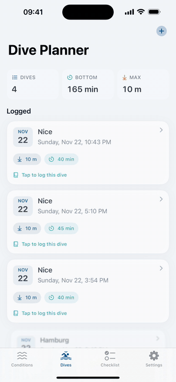
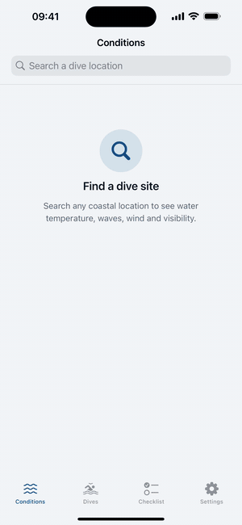
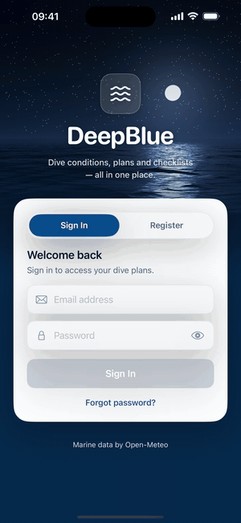
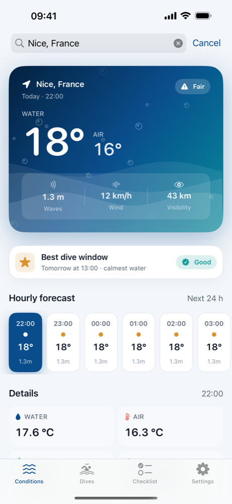
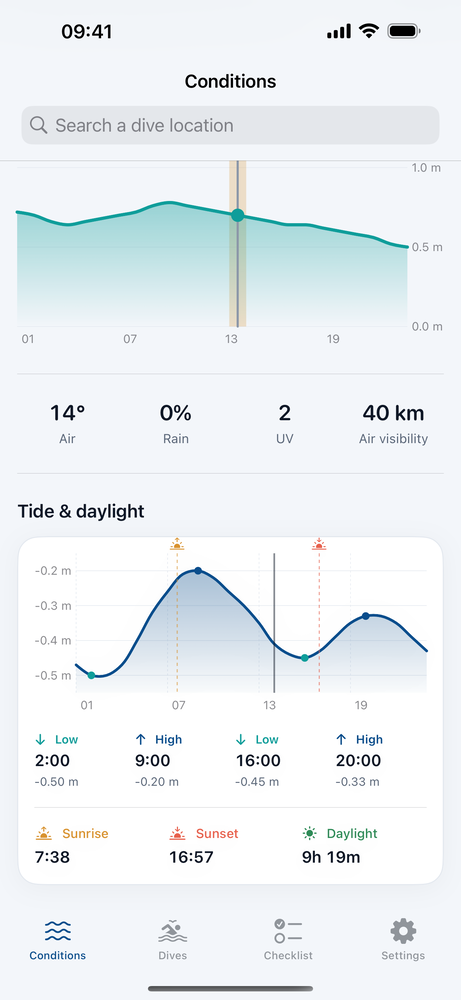
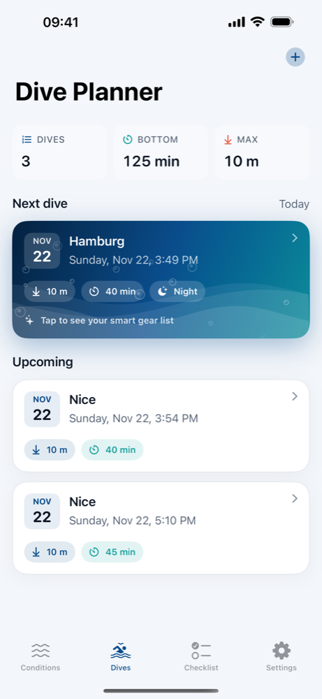
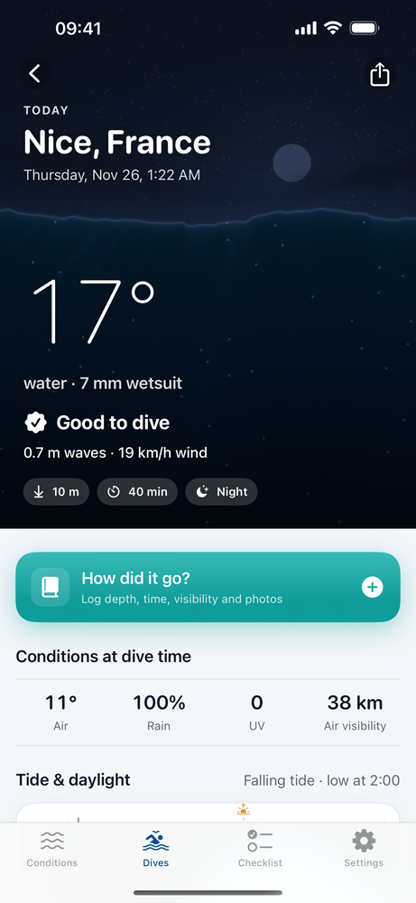
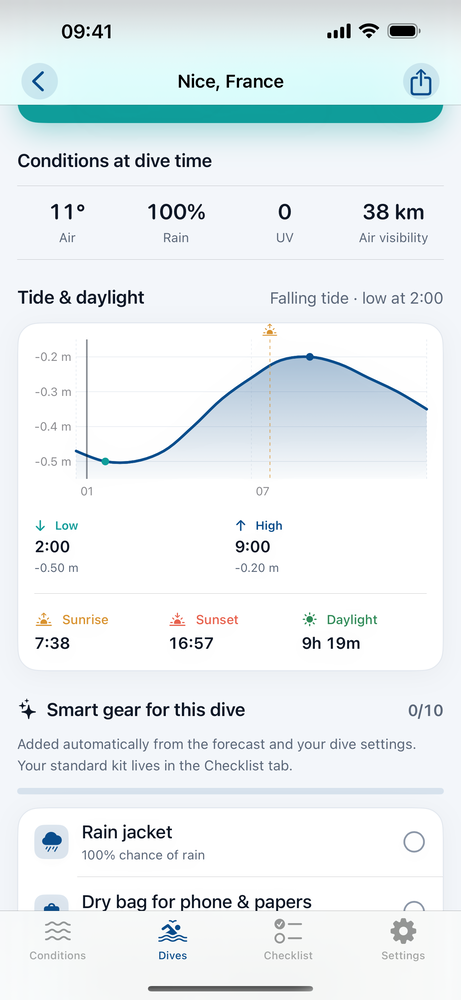
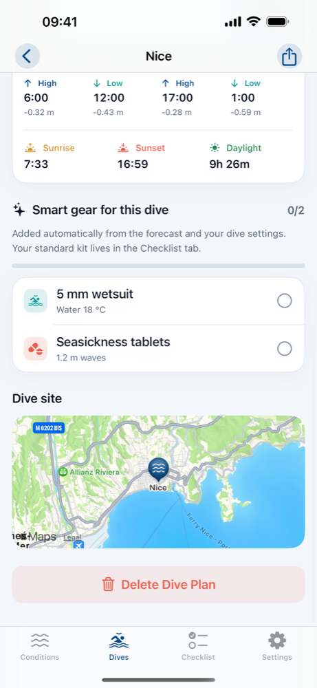
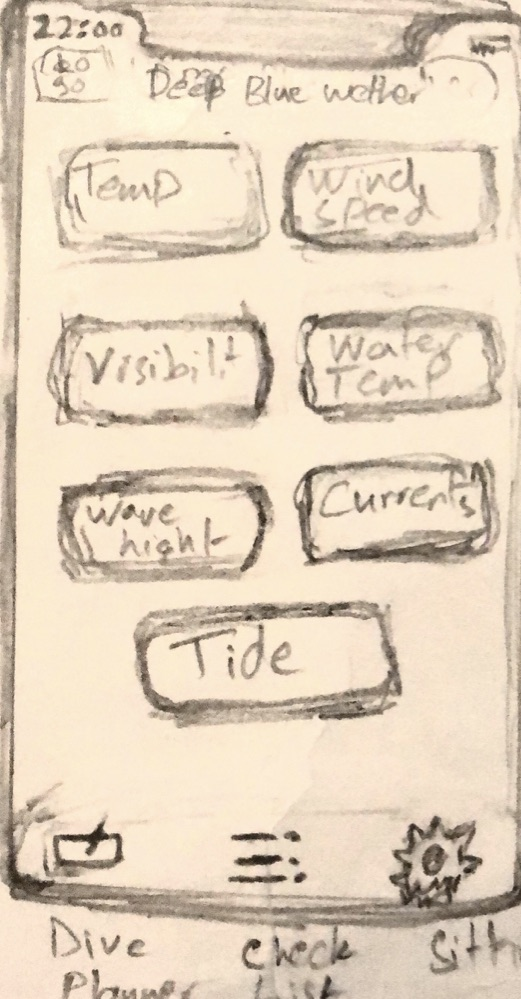

# DeepBlueWeather 🌊

An iOS app for scuba divers: live marine conditions, tides and daylight, dive planning with a **forecast-based gear list for every dive**, a dive log, reminders and a home-screen widget.

Built with **SwiftUI**, **MVVM**, **Firebase** (Auth + Firestore), **WidgetKit**, **Swift Charts** and the free **Open-Meteo** marine & forecast APIs.

## See it in action

| Plan a dive & pack smart gear | Live conditions & tides | Animated ocean design |
|:---:|:---:|:---:|
|  |  |  |

## Screenshots

| Conditions | Tide & daylight | Dive planner | Dive detail |
|:---:|:---:|:---:|:---:|
|  |  |  |  |

| Tide at dive time | Smart gear | Checklist | Login |
|:---:|:---:|:---:|:---:|
|  |  |  |  |

## Features

### Conditions
- Search any location for hourly **water temperature, air temperature, waves, wind, rain chance and visibility**
- A **dive rating** (Excellent → Poor) from wave height and wind
- **Best dive window**: the calmest daylight hour in the next 24 hours
- **Tide chart** (Swift Charts) with high/low times, plus sunrise, sunset and daylight hours

### Dive planner
- Plans are stored in Firestore and sync in real time
- Next dive, upcoming and past dives, plus totals (dives, bottom time, max depth)
- **Dive detail**: conditions at the exact dive time, tide state, and a warning when a dive runs past sunset
- **Share with your buddy**: plan, forecast, tide, gear list and an Apple Maps link as text

### Smart gear list (per dive)
Each dive gets its own packing list, generated from the forecast **for that date and place** and from the plan's settings. Every item shows why it was added:

| Condition | Added gear |
|---|---|
| Rain ≥ 40 % | Rain jacket, dry bag |
| Water < 12 / 18 / 24 / 28 °C | Drysuit, 7 mm, 5 mm or 3 mm wetsuit, hood & gloves |
| UV ≥ 6 or air ≥ 28 °C | Reef-safe sunscreen, hat & sunglasses, extra water |
| Air < 15 °C | Warm jacket, thermos |
| Waves ≥ 1 m / 1.5 m | Seasickness tablets / SMB & reel |
| Night dive | Primary torch, backup torch, tank light |
| Deep dive or > 30 m | SMB, redundant air source, dive computer check |
| ≥ 60 min | Snacks & electrolytes |

The general checklist (equipment, safety, documents, personal) stays in its own tab.

### Dive log
After a dive: actual depth and bottom time, water temperature, visibility, a 1–5 star rating, buddy, notes and photos.

### Reminders & widget
- A local notification at 19:00 the evening before each dive (or 2 hours before for same-day plans)
- A **"Next Dive" widget** (small, medium, Lock Screen) with a countdown, fed through an App Group

### Design
- Custom design system with light and dark colors, an animated ocean background, spring animations, zoom transitions and haptics
- Respects **Reduce Motion**

## From sketch to app

The app started as pencil wireframes. The first sketch already listed tide, waves and water temperature, and all of those are now live data.

| Wireframe | Today |
|:---:|:---:|
|  |  |

## Tech stack

| Area | Technology |
|---|---|
| UI | SwiftUI, Swift Charts, MapKit, PhotosUI |
| Architecture | MVVM, `ObservableObject` view models, async/await |
| Backend | Firebase Auth, Cloud Firestore (real-time listener) |
| Data | Open-Meteo Forecast + Marine API (no API key), CLGeocoder |
| System | WidgetKit, App Groups, UserNotifications |
| Local storage | UserDefaults (checklists), Documents folder (dive photos) |
| Tests | XCUITest walkthrough of every screen |

## Project structure

```
DeepBlueWeather/
├── Models/          DivePlan, DiveLog, WeatherData, Checklist + SmartGearEngine, SharedDiveStore
├── ViewModels/      WeatherViewModel + WeatherService, DivePlannerViewModel, ChecklistViewModel,
│                    LoginViewModel, DiveReminderService
└── Views/
    ├── Screens/     Login, Home (tabs), DivePlanner + DiveDetail, DiveLogSheet, Checklist, Settings
    └── Components/  Design system (StyleConstants), motion toolkit, WeatherInfoView, TideSunCard
DeepBlueWidget/      WidgetKit extension ("Next Dive")
firestore.rules      Security rules: users can only access their own dive plans
```

## Setup

1. Clone the repository and open `DeepBlueWeather.xcodeproj` in Xcode 16 or newer (iOS 17+).
2. Create a Firebase project with **Email/Password Auth** and **Cloud Firestore**.
3. Add your own `GoogleService-Info.plist` to `DeepBlueWeather/` (it is git-ignored).
4. Deploy the security rules from [`firestore.rules`](firestore.rules): paste them in *Firebase Console → Firestore → Rules*, or run `firebase deploy --only firestore:rules`.
5. Run on the simulator. To run on a device, choose your team under *Signing & Capabilities* for both targets and register the App Group `group.Syntax.DeepBlueWeather` (or rename it in both `.entitlements` files and in `SharedDiveStore.swift`).

## Security

- No API keys in the repository. Open-Meteo needs none, and `GoogleService-Info.plist` is git-ignored.
- Firestore rules allow each user to access only their own dive plans.
- Dive photos stay on the device.

## Testing

An automated UI test (XCUITest) walks through every screen: search, dive detail, smart gear, checklist and settings. The screenshots in this README were generated by it.

## Author

Karam Alnaser · [GitHub](https://github.com/karam991)
