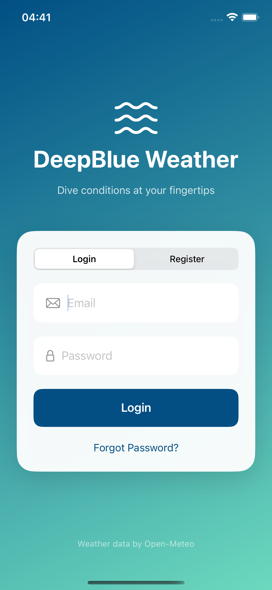
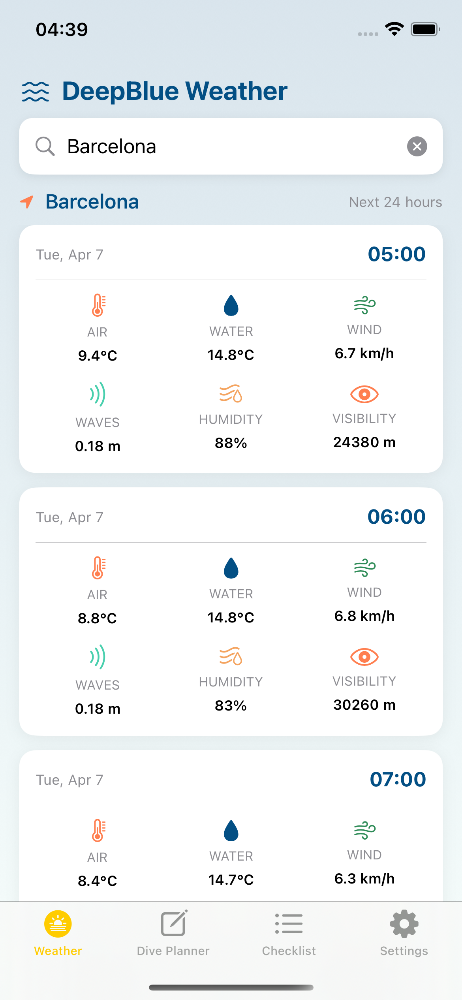
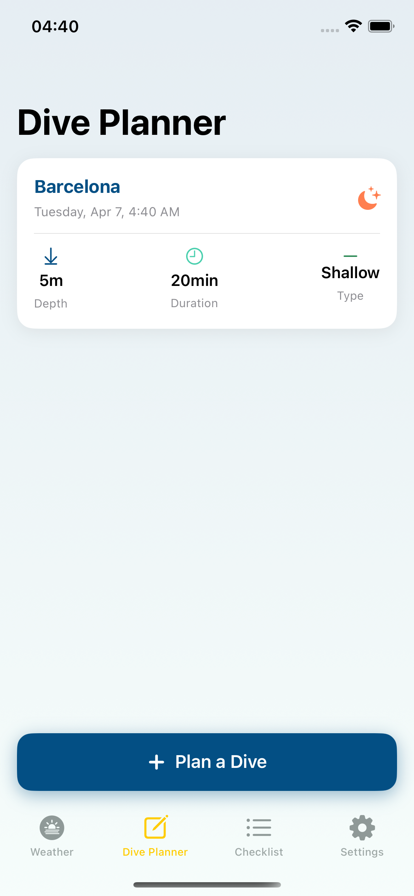
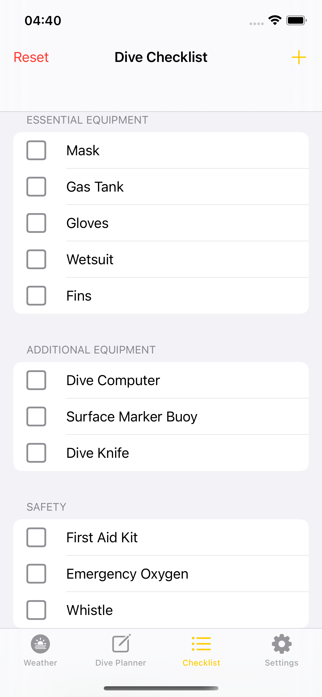

# DeepBlueWeather 🌊

An iOS app for scuba divers that combines marine weather forecasting with dive planning tools. Built with SwiftUI and Firebase.

## Features

- **Marine Weather** — Search any coastal or inland location and get hourly forecasts for air temperature, water temperature, wave height, wind speed, humidity and visibility. Marine data (water temp, waves) shows for coastal locations and gracefully falls back to N/A for inland cities.
- **Dive Planner** — Create, view and delete dive plans stored in Firestore. Each plan includes location, date, depth, duration and dive type. The planner pre-fills weather data from your last weather search.
- **Dive Checklist** — A categorized gear checklist (Essential Equipment, Additional Equipment, Safety, Documentation, Personal) with the ability to add and delete custom items. State persists between launches.
- **Dark Mode** — Fully supported, toggled from Settings.
- **Firebase Authentication** — Email/password registration and login.

## Tech Stack

- **SwiftUI** — Declarative UI with MVVM architecture
- **Firebase Auth** — User authentication
- **Cloud Firestore** — Real-time database for dive plans
- **Open-Meteo API** — Free marine and weather forecast API (no key required)
- **Apple CLGeocoder** — Location name to coordinates conversion
- **async/await** — Modern Swift concurrency throughout
- **UserDefaults** — Local persistence for checklist state

## Architecture

The app follows MVVM (Model-View-ViewModel) pattern:

- `WeatherViewModel` — Handles parallel API calls to Open-Meteo forecast and marine endpoints, exposes weather data to both the Weather tab and Dive Planner sheet via shared environment object
- `DivePlannerViewModel` — Manages Firestore CRUD operations and real-time snapshot listener for dive plans
- `ChecklistViewModel` — Manages checklist state with UserDefaults persistence
- `LoginViewModel` — Handles Firebase Authentication

## Security

- `GoogleService-Info.plist` is excluded from version control via `.gitignore`
- No API keys are hardcoded — Open-Meteo requires no authentication

## Requirements

- iOS 17+
- Xcode 16+
- Firebase project with Authentication and Firestore enabled

## Setup

1. Clone the repository
2. Add your own `GoogleService-Info.plist` from your Firebase project to the `DeepBlueWeather/` folder
3. Open `DeepBlueWeather.xcodeproj` in Xcode
4. Build and run

## Screenshots

| Login | Weather | Dive Planner | Checklist |
|-------|---------|--------------|-----------|
|  |  |  |  |

## Author

Abdulkarim Alnasser
